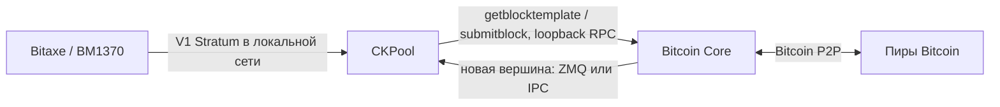

# Пулы Азии и собственный Bitcoin Core / CKPool

Проверка официальных публикаций: **2026-11-12 UTC**. Это исследование архитектуры и опубликованных адресов. Подключения Stratum, сертификаты пулов, реальные выплаты и задержки с домашнего интернета пользователя не испытывались. Прошивка не меняет кошелёк, пулы или порядок резервирования автоматически.

## Опубликованные азиатские точки

| Оператор | Что опубликовано оператором | Условия и границы проверки |
| --- | --- | --- |
| Solo CKPool | Singapore: `sgsolo.ckpool.org`; глобальная точка `stratum.ckpool.org:3333` (V1 TCP). На странице отдельно указан глобальный SV2 `stratum.ckpool.org:3336` с authority key. | [Официальная страница](https://solo.ckpool.org/) указывает комиссию 2%, имя пользователя — собственный Bitcoin-адрес с необязательным worker. Оператор заявляет автоматический выбор ближайшей точки и резервирование для глобального имени. Явный Singapore host лишает этого автоматического резервирования. Страница не публикует отдельный TLS-порт V1 для Singapore; порт и протокол нельзя угадывать. |
| 2Miners Bitcoin SOLO | `asia-solo-btc.2miners.com:2323` (V1 TCP); `asia-solo-btc.2miners.com:12323` (SSL/TLS). Опубликован диапазон share difficulty 32K–16M. | [Официальная инструкция](https://solo-btc.2miners.com/help), [страница Bitcoin SOLO](https://solo-btc.2miners.com/) на дату проверки показывают комиссию 1,5%. Назначение выплат и совместимость шаблона со штатной проверкой coinbase AxeForge не подтверждены. Сертификат TLS с ESP-IDF trust store не проверялся. |

Это два кандидата для ручного испытания, без рейтинга «самый быстрый». Регион из документации оператора не доказывает маршрут пакетов от конкретного iPhone/Bitaxe. География DNS, TCP RTT, время ответа на share и опоздание нового блока — разные величины. Опубликованное состояние сервера не заменяет проверку работы майнера.

Нельзя выключать проверку выплат ради подключения к новому пулу. Если coinbase платит адресу оператора вместо вашего адреса, режим принудительной проверки AxeForge может обоснованно заблокировать работу: проверить модель выплат у оператора, а не обходить защиту. Порог комиссии 3% из исходного тестового контекста не переносится в новые настройки автоматически.

Название `SOLO` описывает распределение вознаграждения, а не гарантирует прямую выплату в coinbase или отсутствие доверия оператору. Ответ `mining.submit=true` подтверждает лишь приём пулом; он не доказывает включение блока в лучшую цепочку Bitcoin.

## Как сравнить два пула

Сохранить рабочий профиль, затем менять только один пул с явным подтверждением. Сравнивать одинаковый стабильный режим и одну сеть BTC; не смешивать BCH/DGB и Bitcoin. Зафиксировать фактическую сложность каждого submit, принятые/rejected/stale, потерянные ответы, переподключения и время отсутствия работы. Отдельно сравнивать появление одинакового prevhash и время до возврата `asic::send_job`. Последнее измеряет передачу драйверу, а не начало хеширования BM1370.

Выполнять повторные окна в разное время. Окно с перегревом, изменением частоты/напряжения, сменой пула, пропавшей связью или недостаточной выборкой непригодно для выбора победителя. Штатный вариант version rolling сохраняется: более частая передача задания сама по себе не доказывает больший полезный хешрейт.

При share difficulty 32768 и постоянных 1,55 TH/s математическое ожидание составляет `32768 × 2^32 / 1,55e12 ≈ 90,8 с` на share, то есть около 20 shares за 30 минут. Это расчёт, а не измерение 2Miners. Короткое окно с требованием 100 подтверждений здесь ожидаемо недостаточно; нужна более длинная выборка, а не снижение критерия после просмотра результата. На chance блока низкая share difficulty сама по себе не влияет.

## Собственный узел

Текущая прошивка разговаривает с Stratum-сервером, а Bitcoin Core предоставляет JSON-RPC. Нельзя вписать RPC-порт `8332` в поле пула Bitaxe и получить самостоятельный соло-майнинг. CKPool либо другой проверенный Stratum-to-node сервер должен построить coinbase/merkle и задания, собрать полный найденный блок и передать его узлу. [Официальный `getblocktemplate`](https://bitcoincore.org/en/doc/30.0.0/rpc/mining/getblocktemplate/) документирует шаблон, segwit rules и longpoll; [`submitblock`](https://bitcoincore.org/en/doc/30.0.0/rpc/mining/submitblock/) принимает полный сериализованный блок.

Для одного устройства разумная проверяемая схема — полностью синхронизированный Core и CKPool на одном постоянно работающем хосте, RPC/ZMQ только на loopback, Stratum доступен только Bitaxe в доверенной локальной сети. В официальной [инструкции CKPool](https://github.com/ckolivas/ckpool/blob/bef6dd2efa2ed803d77fb49fbc064666685cb742/README-SOLOMINING.md) описаны `-B`, `rpcauth`, localhost RPC и `zmqpubhashblock`. Без `-B` смысл `btcaddress` отличается: не переносить настройки между режимами без проверки.

Примерный `ckpool.conf` в upstream содержит чужой Bitcoin-адрес и `donation: 2.0`; его нельзя копировать как личную конфигурацию. В исходниках и прошивке пользователя не добавлены адреса из примеров. Пользователь проверяет собственный адрес и все выходы coinbase до основной эксплуатации. Устанавливать/запускать серверные скрипты из этой задачи не предпринималось.

[Официальная документация безопасности Bitcoin Core RPC](https://github.com/bitcoin/bitcoin/blob/6c7e464293b9cd9b14d24931de1bf86856ec737d/doc/JSON-RPC-interface.md) прямо запрещает считать RPC пригодным для открытого интернета: аутентификация не шифрует трафик. Cookie или отдельно сгенерированный `rpcauth` — на сервере, не в Bitaxe, браузерном HTML или архиве прошивки. [ZMQ Core](https://github.com/bitcoin/bitcoin/blob/6c7e464293b9cd9b14d24931de1bf86856ec737d/doc/zmq.md) также не аутентифицирует подключившихся клиентов. Если узел и CKPool разнесены, требуются защищённый частный канал и явные сетевые ограничения; публикация `8332`/ZMQ наружу не нужна.

Локальный Stratum уменьшает один участок пути до сервера, но скорость получения вершины и распространения блока зависит от Core, пиров, шаблона, диска и внешней сети. Собственный узел без хороших пиров/доступности может проигрывать оператору пула. CKPool сам предупреждает о требованиях к подключению и возможной дополнительной задержке pruned node. Без замеров нельзя обещать выигрыш в BTC или вероятности блока.

## Ограничения этой сборки

- Встроенная классификация «известный BTC» использует список хостов, а не проверку Bitcoin Core. Она не является независимым доказательством консенсусной валидности шаблона. Для любого произвольного Stratum-сервера принадлежность сети требует отдельной проверки.
- Локальный кандидат по hash/compact target, ACK пула, `submitblock` узла и подтверждение лучшей цепочки — отдельные состояния. ESP32 не проверяет полный блок и историю сложности Bitcoin.
- Свой Core/CKPool, Singapore CKPool и 2Miners не развернуты и не испытаны на Gamma в этой задаче. Они не становятся готовой конфигурацией только из-за наличия ссылки в отчёте.

## Воспроизводимость источников

Просмотрены только страницы самих операторов и официальные проекты. Для изменяемых исходников зафиксированы коммиты: CKPool mirror `bef6dd2efa2ed803d77fb49fbc064666685cb742` ([официальное зеркало](https://github.com/ckolivas/ckpool)); Bitcoin Core `6c7e464293b9cd9b14d24931de1bf86856ec737d` ([официальный проект](https://github.com/bitcoin/bitcoin)). Состояние веб-страниц пулов может измениться после даты проверки. Проверенные источники и SHA-256 загруженных публикаций перечислены в `reports/pool-source-evidence.json`.
